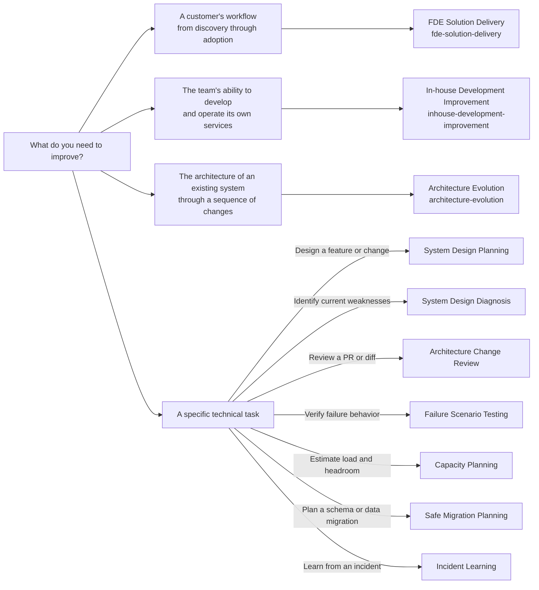

# System Design Skills

Agent skills for improving in-house development, delivering customer solutions, evolving architecture, reviewing changes, and planning reliable operations.

## Skills

| Skill | When to use it | What you get |
| --- | --- | --- |
| [System Design Planning](skills/system-design-planning/SKILL.md) | Before building a feature or changing architecture | Recommended design, alternatives, failure handling, delivery steps, and validation criteria |
| [System Design Diagnosis](skills/system-design-diagnosis/SKILL.md) | To assess an existing product | Findings ranked P0–P3, evidence, response options, and recommended next steps |
| [Failure Scenario Testing](skills/failure-scenario-testing/SKILL.md) | When the happy path works but failure behavior is uncertain | Retry, race, timeout, and interruption cases; focused test implementation and results when in scope |
| [Architecture Change Review](skills/architecture-change-review/SKILL.md) | To review a PR or diff for system-level risks | Evidence-backed findings on consistency, compatibility, load, and authorization |
| [Safe Migration Planning](skills/safe-migration-planning/SKILL.md) | Before a schema change or data migration | Version compatibility, migration stages, monitoring gates, abort actions, and recovery limits |
| [Capacity Planning](skills/capacity-planning/SKILL.md) | To estimate growth, peak load, or failure headroom | Explicit assumptions and estimates for connections, concurrency, backlog, and bottlenecks |
| [Incident Learning](skills/incident-learning/SKILL.md) | After an incident | Evidence-linked timeline, causal factors, and prioritized actions with verification criteria |
| [In-house Development Improvement](skills/inhouse-development-improvement/SKILL.md) | When delivery, ownership, setup, or handover prevents independent development and operation | Evidence-backed bottlenecks, prioritized improvements, and proof of team capability |
| [Architecture Evolution](skills/architecture-evolution/SKILL.md) | When an existing system needs multiple coordinated architectural changes | Target boundaries, useful intermediate states, a staged roadmap, validation gates, and recovery limits |
| [FDE Solution Delivery](skills/fde-solution-delivery/SKILL.md) | When a customer workflow needs discovery, integration, a pilot, or adoption support | Business outcomes, data/access readiness, acceptance cases, pilot criteria, and operational handover conditions |

All ten use 212 system-design Tips to support decisions and communicate in your language. Planning, review, diagnosis, or retrospective analysis alone does not change your product or production settings. Failure testing can include focused local tests; production experiments require their own authorized scope.

## Choosing a skill

Choose by the question you need answered. In-house Development Improvement, Architecture Evolution, and FDE Solution Delivery coordinate broader improvement and customer delivery work. The other seven skills develop specific design, assessment, verification, and operational tasks in more detail. Each skill works independently; use them together when the task crosses those boundaries.



### Broader workflows and their boundaries

| Skill | Main question | Expected output |
| --- | --- | --- |
| FDE Solution Delivery (`fde-solution-delivery`) | How can we deliver a technical solution that improves a customer's workflow and remains usable in daily operations? | Observed workflow and desired outcomes, data and access readiness, stakeholder decisions, solution experiments, business acceptance cases, pilot criteria, and operational handover conditions |
| In-house Development Improvement (`inhouse-development-improvement`) | What prevents the team from independently changing and operating its services? | Evidence of bottlenecks across setup, implementation, review, delivery, handover, and operations; prioritized improvements with completion criteria |
| Architecture Evolution (`architecture-evolution`) | How can we reshape an existing system while continuing to develop and operate it? | Current constraints, target responsibilities and data ownership, a sequence of architectural changes, and validation criteria for each stage |

FDE (Forward Deployed Engineering) Solution Delivery focuses on customer workflow outcomes, acceptance, and adoption. In-house Development Improvement focuses on the team's delivery and operating practices. Architecture Evolution focuses on the path from the current system to a target architecture. All three identify where more focused skills can develop individual parts of the work in more detail.

System Design Diagnosis identifies and prioritizes weaknesses in the current system. System Design Planning designs a particular feature or architectural change, including its delivery sequence. Architecture Evolution connects multiple changes into a broader roadmap. Safe Migration Planning develops the compatibility, monitoring, abort, and recovery details for an individual schema or data migration within that roadmap.

For an AI-assisted customer support project, FDE Solution Delivery establishes the current workflow, desired business outcomes, usable data, decision owners, and acceptance cases; compares rules, search, and AI where appropriate; and defines pilot and handover criteria. System Design Planning develops the chosen solution's architecture and integrations.

For example, splitting a large existing service could combine the skills as follows. These are handoffs between tasks, not automatic skill invocations:

1. **Architecture Evolution:** choose boundaries and the order in which responsibilities move.
2. **System Design Planning:** design the first extraction, including data flows and failure handling.
3. **Safe Migration Planning:** plan any schema or data migration required by that extraction.
4. **Architecture Change Review and Failure Scenario Testing:** review the implementation and verify relevant failure behavior.

## Usage

Clone this repository, then ask your agent from the product you want to work on. Replace the path with your local checkout:

```text
Use /path/to/system-design-skills/skills/system-design-planning/SKILL.md
to design this feature. Compare practical options and recommend an
architecture, failure handling, implementation sequence, and validation.
```

For other tasks, use the corresponding `SKILL.md` from the table. If installed in your agent, invoke a skill by its directory name, for example:

```text
$failure-scenario-testing Check whether retrying this webhook after a timeout can duplicate its effects, and add focused local tests where needed.
$architecture-change-review Review this diff for consistency, compatibility, load, and authorization risks.
$safe-migration-planning Plan this column migration while old and new application versions coexist, including abort and recovery conditions.
$capacity-planning Estimate what breaks first at 10x usage, including DB connections, worker concurrency, queue recovery, and one-zone failure.
$incident-learning Use these logs and the incident timeline to explain the contributing factors and propose verifiable improvements.
$inhouse-development-improvement Identify what prevents our team from independently changing and operating this service, and prioritize improvements with completion evidence.
$architecture-evolution Plan how to split this existing service through useful intermediate states while development continues, including data ownership and recovery limits.
$fde-solution-delivery Turn this customer workflow problem into a solution and adoption plan with data/access readiness, business acceptance cases, and pilot and handover criteria.
```

## Included Tips

Each skill bundles the same 212 English Tips with explanations, trade-offs, and source links, extracted from the `system-design-skill-developer` learning catalog. Every skill works independently of this repository's other skills and the original catalog.

The helper requires Python 3, with no additional dependencies. For example, from this repository's root:

```sh
python3 skills/system-design-planning/scripts/tips.py search webhook
python3 skills/system-design-planning/scripts/tips.py show webhook-verification idempotency-keys
```

Maintain the canonical bundle in `system-design-diagnosis`, then synchronize the standalone copies:

```sh
python3 skills/system-design-diagnosis/scripts/tips.py refresh --source /path/to/catalog.en.json
python3 scripts/sync_tips.py
python3 scripts/sync_tips.py --check
```

Review the generated diff after updates. Tips are guidance; verify relevant product versions and primary sources before applying them.

## License

[MIT](LICENSE). Linked third-party references retain their own licenses.
